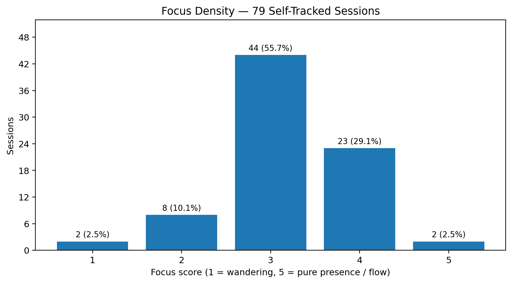
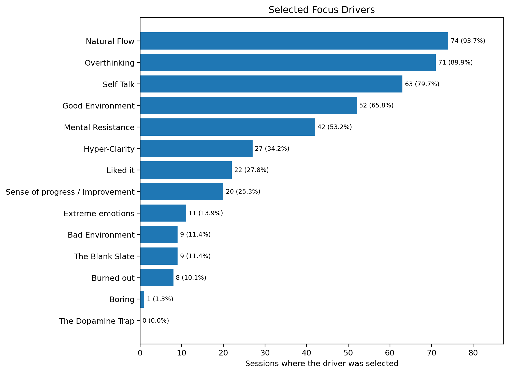
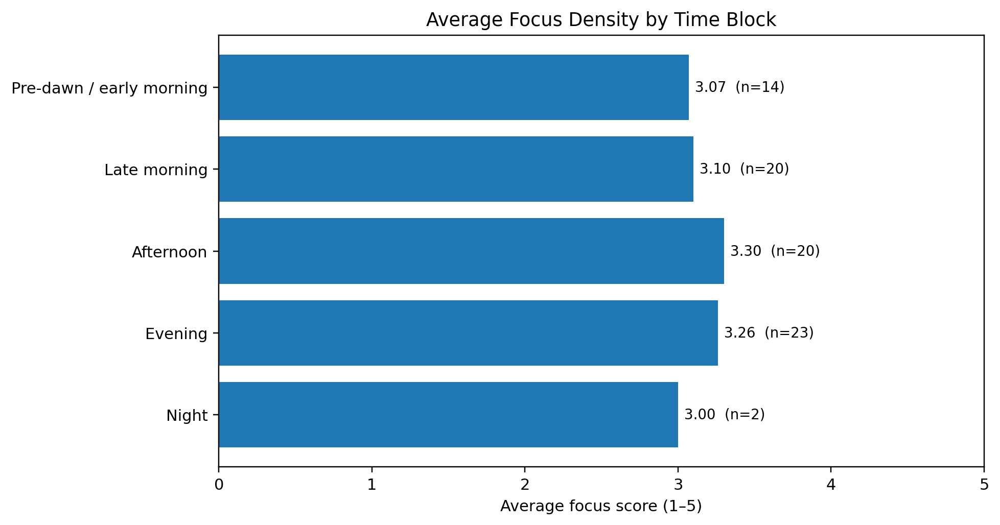

# Focus Tracker

*A small self-tracking project about focus, attention, and the way I spend my time.*

I wanted to work on a data project that was useful to me, not just download a Kaggle dataset, calculate a few averages, and call it finished. I was curious about my own focus: when do I feel present, what pulls my attention away, and what do I notice after different activities?

So I made a Google Form, connected it to Google Sheets, and recorded my own activity sessions for a short period. The idea was simple: **log the focus, the stillness, the presence — ignore the outcome.**

This is a personal experiment and a record of what I observed about myself. It is not a study of other people, and it does not claim to explain human focus in general.

## Project snapshot

| Item | Result |
|---|---:|
| Self-recorded sessions | 79 |
| Collection period | 12–22 May 2026 |
| Dates with records | 9 |
| Average focus score | 3.19 / 5 |
| Final questionnaire | 4 required questions |
| Activity choices | 13 |
| Time blocks | 5 |
| Possible focus drivers | 14 |

## What I built

The data collection flow was:

**Google Form → Google Sheets → filters, pivot tables, insights, and charts**

The form asked what I was doing, which time block it was, how I would rate my focus, and which factors I felt were present. The driver question allowed multiple selections because I did not want to force a session into just one explanation.

The questionnaire and the rules I used while logging are documented in [`docs/QUESTIONNAIRE.md`](docs/QUESTIONNAIRE.md) and [`docs/METHODOLOGY.md`](docs/METHODOLOGY.md).

## A few results

The overall average was **3.19 out of 5**. Most entries were rated 3 or 4.

| Focus score | Sessions | Share |
|---:|---:|---:|
| 1 | 2 | 2.5% |
| 2 | 8 | 10.1% |
| 3 | 44 | 55.7% |
| 4 | 23 | 29.1% |
| 5 | 2 | 2.5% |

The most frequently selected drivers in the exported response rows were:

| Driver | Sessions selected |
|---|---:|
| Natural Flow | 74 |
| Overthinking | 71 |
| Self Talk (Bismillah...) | 63 |
| Good Environment | 52 |
| Mental Resistance | 42 |

The driver question allowed multiple selections, so these counts overlap and do not add up to 79.

## Charts

These visualisations were recreated from the 79 recorded sessions in the exported Excel workbook.

### 1. Focus Density Distribution

How frequently I rated my focus at each level, from 1 (wandering) to 5 (pure presence).



### 2. Frequently Selected Focus Drivers

The factors I selected while recording my sessions. Multiple drivers could be selected for one session, so these counts overlap.



### 3. Average Focus by Time Block

A comparison of my average focus ratings across different times of the day. The Night category contains only two observations, so its average should be interpreted cautiously.



### Additional Visualisations

- [Average Focus by Activity](assets/charts/average-focus-by-activity.png)
- [Number of Sessions by Activity](assets/charts/sessions-by-activity.png)

## What I noticed

A few questions became more interesting as I explored the entries:

- **Movement & Creation:** I looked at the eight sessions where I did not select Overthinking. Three were Calisthenics, two were Talk / Social Connection, two were Unstructured Screen Time, and one was YouTube Content Creation.
- **The Flow Assassin:** all five sessions without Natural Flow had a score of 1 or 2, and all five included Overthinking. Three also included Good Environment. That made me question the idea that a quiet room is enough on its own.
- **The Anatomy of a 4:** all 23 score-4 sessions included Natural Flow; 21 also included Overthinking. That made me think differently about whether every distracting thought has to disappear before I can focus.
- **The Golden Hour:** the averages across time blocks were close in this dataset. I did not find a strong time-of-day pattern.
- **The Autopilot Trap:** the activity averages made me think about how familiar actions can become automatic. The spreadsheet raised the question; my own experience shaped the interpretation.

The full reasoning, numbers, and limitations are in [`docs/INSIGHTS.md`](docs/INSIGHTS.md). The chronological story is in [`docs/DEVELOPMENT_LOG.md`](docs/DEVELOPMENT_LOG.md).

## Analysis workbook

[`analysis/Focus_Tracker_Analysis.xlsx`](analysis/Focus_Tracker_Analysis.xlsx) contains:

- an overview of the 79 records;
- the session-level export;
- activity and time-block summaries;
- driver counts; and
- notes about interpretation and source differences.

The session sheet contains the exact Google Forms submission timestamps together with my own self-tracking entries. These are my records, not data about other respondents.

## How to read this project

A focus score is my own rating, not an objective measurement. The data comes from one person, over a short period, and some activity groups have very few sessions. Averages can hide different experiences, and a relationship in this dataset does not prove cause and effect.

I used the numbers to ask better questions, then checked those questions against what I remembered about the sessions. The data showed patterns; it could not explain every reason by itself.

## Repository contents

```text
Focus-Tracker/
├── README.md
├── .gitignore
├── analysis/
|   ├── README.md
│   └── Focus_Tracker_Analysis.xlsx
├── assets/
│   └── charts/
│       ├── average-focus-by-activity.png
│       ├── average-focus-by-time-block.png
│       ├── driver-selection-frequency.png
│       ├── focus-density-distribution.png
│       └── sessions-by-activity.png
└── docs/
    ├── DATA_DICTIONARY.md
    ├── DEVELOPMENT_LOG.md
    ├── INSIGHTS.md
    ├── METHODOLOGY.md
    └── QUESTIONNAIRE.md
```

## Final reflection

I started by looking for what was wrong with my environment or schedule. I ended up paying more attention to my own presence in the activity.

My personal takeaway from this experiment is:

> **Focus in me & my moment.**

That is my reflection from these 79 entries, not a universal rule. The value of the project was learning to collect observations, question my first interpretation, and look again when the numbers did not tell the whole story.
